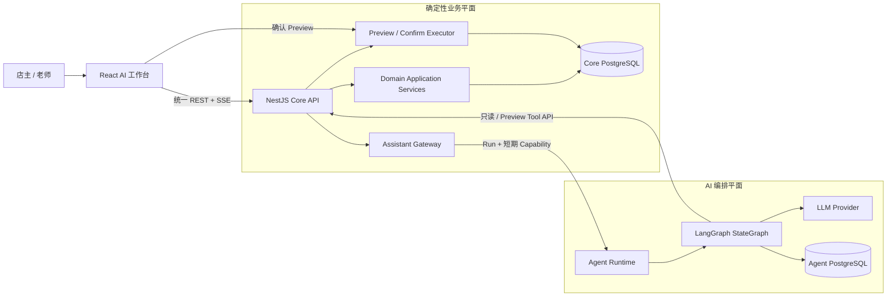
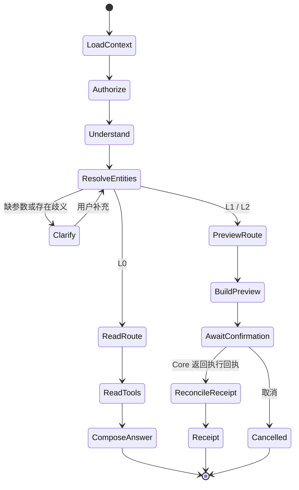

# 琴行管理系统 AI Native 技术设计（MVP v1.0）

> 状态：技术评审稿。  
> 版本：v1.0  
> 编制日期：2026-10-15  
> 业务基线：《系统需求设计 V2（MVP v1.0）》  
> AI 产品基线：《系统需求设计 AI Native（MVP v1.0）》

## 1. 文档目标

本文定义 AI Native MVP 的系统边界、技术选型、Agent 编排、业务工具、确认协议、数据模型、并发控制、接口、前端、测试和分阶段实施方案。

本文按全新系统从零设计，只描述目标架构和实施路径。实施状态以实际代码、数据库结构和测试结果为准。

本轮设计遵循 MVP：只拆分安全边界明确的“业务核心”和“Agent Runtime”两个服务，不进一步拆领域微服务，
不引入向量数据库、Redis、多智能体、长期记忆和自主执行。

## 2. 核心技术决策

| 决策 | MVP 选择 | 原因 |
|---|---|---|
| 部署形态 | 业务核心与 Agent Runtime 两个服务 | 将不可信模型运行时与资金、权限和业务数据库物理隔离。 |
| 开发语言 | 全栈 TypeScript | LangGraph.js 已覆盖本期所需的 StateGraph、interrupt、stream 和 Postgres checkpointer；无需仅为 Agent 引入第二语言。 |
| 业务核心 | NestJS 模块化单体 | 一个服务承载全部确定性领域规则和事务，不拆领域微服务。 |
| Agent Runtime | Fastify + LangGraph.js | 运行时保持轻量，专注会话、模型、Graph、流式事件和工具 HTTP Client。 |
| Agent 编排 | LangGraph.js `StateGraph` | 写操作需要显式状态、暂停恢复、严格分支和可测试节点，不适合完全自由的 ReAct 循环。 |
| 模型与工具适配 | LangChain.js | 统一模型、结构化输出、工具 Schema 和可替换供应商接口。 |
| DeepAgents | MVP 不进入在线业务主链路 | 其规划、文件系统、子 Agent 和长期任务能力超出本期范围，也扩大资金操作的不可控面。 |
| 业务写入 | 浏览器直接向业务核心确认 | Agent 只能查询和申请生成预览，网络和凭证层面都不能调用执行接口。 |
| 业务持久化 | PostgreSQL + Prisma | 业务核心独占业务库，负责金额、事务、Preview、执行回执和审计。 |
| Agent 持久化 | 独立 PostgreSQL 数据库 | 使用官方 Postgres checkpointer 保存 Graph 状态，Agent 无业务库凭证。 |
| 流式交互 | HTTP SSE | 满足回答、进度和工作区事件流；MVP 不需要 WebSocket 双向常连接。 |
| 检索 | 结构化查询工具 | 余额、报表、课表和工资来自数据库计算，不使用向量检索替代业务查询。 |

### 2.1 架构方案比较

| 方案 | 优点 | 主要问题 | 结论 |
|---|---|---|---|
| Agent 内嵌业务 API | 部署最少、调用简单 | 模型运行时和业务库处于同一进程，权限边界依赖代码自觉，模型负载会影响核心业务 | 不选。 |
| 业务核心 + 独立 Agent Runtime | Agent 无业务库权限，可独立降级和扩缩；业务事务仍在单体内完成 | 增加一次内部 HTTP 调用和服务间鉴权 | **推荐。** |
| LangGraph Agent Server / 平台 | 自带线程、运行、队列和流式 API | MVP 需要额外 Redis、平台部署与许可决策，基础设施明显变重 | 暂不选。 |
| 全部使用 DeepAgents | 复杂任务能力开箱即用 | 规划、文件系统、子 Agent 和长期记忆与交易型场景不匹配 | 暂不选。 |

所选方案不是领域微服务化。所有账户、课消、退款、工资、关账和报表仍在一个业务核心服务、一个业务数据库中完成；
独立的 Agent Runtime 只是隔离模型风险和长连接负载。

## 3. 总体架构



### 3.1 信任边界

- 浏览器不可信：角色、老师身份、金额计算结果和可执行参数不能只相信前端。
- 模型输出不可信：所有意图、实体 ID、日期、金额和工具参数必须经过 Schema 与业务服务校验。
- 业务备注和查询结果是数据，不是指令；不得将其中的文本提升为系统提示。
- 业务服务和数据库约束是最终正确性边界；Agent 只是新的交互与编排入口。
- Agent Runtime 没有 Core PostgreSQL 连接串，也没有确认执行接口的服务凭证。
- Core API 没有模型 API Key；模型供应商异常或 Agent Runtime 下线不影响结构化业务入口。

### 3.2 请求类型

系统只接受三类 AI 请求：

1. **L0 查询**：Agent 使用短期 Capability 调用 Core 只读工具并组织结果。
2. **L1/L2 预览**：Agent 只能请求 Core 生成并保存结构化预览。
3. **确认执行**：用户浏览器携带本人登录态直接调用 Core 确认接口；Agent 不转发确认凭证，也不能代用户执行。

## 4. LangChain、LangGraph 与 DeepAgents 分工

### 4.1 LangChain.js

只使用下列基础能力：

- Chat Model 抽象和供应商适配；
- Zod 结构化输出；
- 工具定义与参数校验；
- 消息类型和必要的模型中间件。

不使用 LangChain 构造第二套业务规则。工具返回的是业务服务给出的结构化事实，模型只负责意图理解、最少补问和表达。

### 4.2 LangGraph.js

使用显式 `StateGraph`，承担：

- 意图分类和路由；
- 参数补齐与同名对象消歧；
- 多步骤只读查询；
- 写操作预览；
- 人工确认前的暂停与恢复；
- 运行状态持久化和故障恢复；
- 流式输出和工作区事件。

LangGraph 的 interrupt 会持久化图状态并等待外部输入，适合确认流程；恢复时中断节点会从头执行，因此中断调用之前不得放置非幂等副作用。
MVP 将“申请生成预览”“等待确认”“接收执行回执”拆为三个节点，实际执行始终发生在 Core API，不属于 Graph 节点。

### 4.3 DeepAgents

DeepAgents 建立在 LangChain/LangGraph 之上，适合需要任务规划、文件系统、子 Agent、上下文压缩和长时间运行的开放式任务。当前冻结需求明确不做多智能体、长期记忆和自主工作流，因此 MVP 不使用 `createDeepAgent` 处理在线经营操作。

可在后续版本单独评估两个只读场景：

- 跨月经营分析和管理复盘；
- 多步骤经营问题调查和报告草稿生成。

即使后续引入，DeepAgent 也只能调用受控只读工具或生成待确认计划，不能获得数据库、Shell、文件系统或通用业务写权限。

## 5. 代码组织与模块边界

目标仓库按部署边界组织：

```text
apps/
  web/                         React AI 工作台与结构化降级页面
  core-api/                    NestJS 确定性业务核心
    prisma/schema.prisma
    src/modules/
      assistant-gateway/       Run 转发、SSE 代理、Capability 签发
      assistant-actions/       Preview、Confirm、Receipt、业务审计
      internal-tools/          只读与 Preview 内部 API
      student-course-accounts/
      lessons/
      ledger/
      payments/
      gifts/
      refunds/
      payroll/
      finance/
      periods/
  agent-runtime/               Fastify + LangGraph.js
    migrations/                AgentThread/Message/Run 技术表
    src/
      graph/
      nodes/
      tools/                   Core Tool API 的类型化 Client
      model/
      runs/
      events/
packages/
  assistant-protocol/          Workspace、SSE、Intent 等非领域传输协议
  generated-core-client/       由 Core OpenAPI 生成，不手写领域 DTO
```

依赖方向固定为：

```text
Web → Core Public API / Assistant Gateway
Agent Runtime → Core Internal Read / Preview API
Core Controller → Domain Application Service → Repository → Prisma
```

禁止：

- Agent Runtime 连接 Core PostgreSQL；
- Agent Runtime 调用 Confirm/Execute API；
- Core API 保存或使用模型供应商密钥；
- Controller 编写业务规则；
- 工具自行计算余额、手续费、工资或报表；
- Agent Runtime 手写一份 Core 领域枚举或 DTO；
- 前端根据自然语言结果推断能否执行。

## 6. Agent 状态机

### 6.1 状态定义

Graph State 只保存编排所需数据，不保存模型思维链：

```ts
type AssistantState = {
  threadId: string;
  runId: string;
  actor: { userId: string; role: UserRole; teacherId?: string };
  userMessage: string;
  taskContext: {
    studentId?: string;
    courseTypeId?: string;
    teacherId?: string;
    period?: string;
  };
  intent?: IntentEnvelope;
  missingFields: string[];
  candidates: EntityCandidate[];
  toolResults: ToolResultEnvelope[];
  previewId?: string;
  workspace?: WorkspaceDocument;
  answer?: string;
  error?: PublicAssistantError;
};
```

其中 `UserRole` 来自 Core OpenAPI 生成的 Client，不在 Agent Runtime 中重新声明。金额在 Graph State、工具参数和 JSON 中一律使用十进制定点字符串，
例如 `"200.00"`。只有领域服务使用 Prisma Decimal 做运算。

### 6.2 主流程



### 6.3 节点职责

| 节点 | 是否调用模型 | 是否允许副作用 | 职责 |
|---|---:|---:|---|
| `load_context` | 否 | 否 | 加载账号、角色、当前任务和最近业务引用。 |
| `authorize_intent` | 否 | 否 | 根据角色裁剪可用意图和工具。未知意图默认拒绝写入。 |
| `understand` | 是 | 否 | 生成结构化 `IntentEnvelope`，不生成业务结论。 |
| `resolve_entities` | 否 | 否 | 用数据库精确匹配 ID；同名时生成候选卡。 |
| `clarify` | 可选 | 否 | 用 interrupt 等待用户选择或补充最少字段。 |
| `read_tools` | 否 | 否 | 执行受权的结构化查询。 |
| `compose_answer` | 是 | 否 | 基于工具结果生成解释；数字随结果引用，不重新计算。 |
| `build_preview` | 否 | 申请创建幂等预览 | 使用短期 Capability 调用 Core Preview API。 |
| `await_confirmation` | 否 | 否 | interrupt 等待确认、修改或取消。 |
| `reconcile_receipt` | 否 | 否 | 接收 Core 回传的执行回执并与 `previewId` 核对，不执行业务。 |
| `receipt` | 可选 | 否 | 返回业务回执；模型失败时仍显示结构化回执。 |

### 6.4 一句话多个动作

MVP 允许识别多个动作，但不做开放式自主规划：

- 只读动作可以顺序或并行执行。
- 多个 L1/L2 动作生成一个有顺序的计划，但每个资金或关键状态动作都有独立预览和确认状态。
- 后续动作依赖前一步结果时，前一步成功后重新生成后一步预览。
- 不支持“一次确认任意数量的混合资金动作”；批量排课是一个明确的领域命令，不属于任意批处理。

## 7. 业务工具设计

### 7.1 工具原则

1. 工具按业务意图命名，不提供 `query_database`、`update_record` 等通用能力。
2. 工具参数使用业务 ID 和经过验证的值，不接受任意 SQL、筛选表达式或字段名。
3. 工具执行前后都校验角色和数据范围。
4. 工具返回 DTO、来源记录 ID 和显示建议，不返回 ORM 实体。
5. 工具错误使用稳定错误码，模型只能解释，不能吞掉失败或改称成功。
6. 写操作工具只生成预览；真正执行能力不注册给模型。

### 7.2 MVP 工具清单

只读工具：

| 工具 | 主要输入 | 输出 |
|---|---|---|
| `get_today_overview` | 日期 | 今日课表、待确认、欠费和异常摘要。 |
| `search_students` | 姓名关键词 | 受权限过滤的候选学生。 |
| `get_student_course_accounts` | 学生 ID | 各课程实收、赠送、总余额、单价和状态。 |
| `get_student_ledger` | 学生/课程/日期 | 流水及来源记录。 |
| `list_lessons` | 日期范围/老师/学生/状态 | 课表和冲突相关信息。 |
| `get_teacher_month_result` | 老师/月 | 业绩、工资计算和支付状态。 |
| `get_finance_report` | 月份/口径 | 现金或经营结果及明细引用。 |
| `list_debt_students` | 可选老师 | 欠费课程账户。 |
| `list_frozen_students` | 可选老师 | 动态冻结学生。 |

预览工具：

| 工具 | 风险 | 预览能力 |
|---|---:|---|
| `preview_create_or_update_master_data` | L1 | 基础资料变更前后对比。 |
| `preview_schedule_lessons` | L1 | 单节/按周批量排课及冲突检查。 |
| `preview_reschedule_lesson` | L1 | 原时间、新时间和冲突检查。 |
| `preview_cancel_lesson` | L1 | 课程状态变化，不产生扣费。 |
| `preview_complete_lesson` | L2 | 单价快照、赠送/实收扣减和欠费影响。 |
| `preview_reverse_lesson_completion` | L2 | 反向流水和课程状态恢复。 |
| `preview_payment` | L2 | 指定课程实收余额变化和渠道。 |
| `preview_gift` | L2 | 指定课程赠送余额及经营成本。 |
| `preview_final_refund` | L2 | 各课程清零、手续费比例、实际退款和退学状态。 |
| `preview_payroll_payment` | L2 | 月份、实发金额、渠道和支付日期。 |
| `preview_manual_transaction` | L2 | 固定分类、现金与经营口径影响。 |
| `preview_close_or_reopen_period` | L2 | 锁定范围、最近关账限制和影响记录。 |
| `preview_reversal` | L2 | 被冲正记录、反向金额和当前开放月份。 |

## 8. 预览、确认与执行协议

### 8.1 预览记录

每个 L1/L2 预览由 Core API 持久化为 `ActionPreview`，至少包含：

- `id`、`threadId`、`runId`、`actorUserId`；
- `actionType`、`riskLevel`；
- 规范化命令 `commandJson`；
- 结构化展示 `displayJson`；
- 涉及资源及其版本 `resourceVersionsJson`；
- `status`：`PENDING / EXECUTING / EXECUTED / EXPIRED / CANCELLED / STALE / FAILED`；
- `expiresAt`、`confirmedAt`、`executedAt`；
- `idempotencyKey` 和关联业务记录 ID。

`commandJson` 中金额只能是字符串，不能用 JSON number。预览是待执行命令，不是余额或报表的事实来源。

### 8.2 确认流程

```text
Agent 解析意图
  → Agent 使用短期 Capability 请求 Core Preview API
  → Core Preview Service 读取实时状态、计算影响并保存 preview + 资源版本
  → 前端按 actionType 渲染确认卡
  → 用户浏览器直接向 Core API 点击确认
  → Core API 用用户登录态重新鉴权并锁定 preview
  → 锁定业务聚合、验证版本与关账状态
  → 失效：标记 STALE，重新预览
  → 有效：同一事务执行领域命令、写审计、标记 EXECUTED
  → Core 返回可重复查询的回执，并以内部事件恢复等待中的 Graph
```

Core 确认端点不接受 Agent Runtime 的服务身份，只接受当前用户登录态。原始自然语言只用于审计，不作为执行输入；
执行器只使用预览中已经规范化并通过 Schema 校验的命令。

### 8.3 严格确认

L2 确认请求必须同时提交：

- `previewId`；
- 前端生成并在重试时复用的 `clientRequestId`；
- 明确的 `decision: "CONFIRM"`；
- 当前展示的 `previewVersion`。

服务端重新读取登录身份，禁止从请求体接受 `actorUserId` 或角色。确认按钮只是用户意图证据，不替代权限和业务校验。

### 8.4 幂等

- `ActionPreview.idempotencyKey` 唯一；同一 Graph 节点重放只返回原 Preview。
- 每种领域写记录保留对应的 `commandId` 唯一键，避免执行器在提交成功但响应丢失后重复写入。
- 同一 `previewId` 重复确认时：已成功则返回原回执；处理中则返回当前状态；失效或失败则不得悄悄新建第二笔业务。
- 不确定结果先查 `GET /assistant/actions/{previewId}`，不能由 Agent 自行重试写入。

### 8.5 预览失效

以下任一变化使原预览失效：

- 课程账户单价、版本或流水版本变化；
- 课程时间、老师、状态或版本变化；
- 工资参数、支付状态变化；
- 关账状态变化；
- 用户角色、账号状态或老师绑定变化；
- 超过预览有效期。

MVP 默认有效期建议为 15 分钟，可配置。失效后保留旧预览用于审计，但必须重新计算并再次确认。

## 9. 目标领域模型

`apps/core-api/prisma/schema.prisma` 是业务数据模型唯一来源。下表是建模要求，不在 Agent Runtime、前端或共享包中重复定义实体。

### 9.1 建模决策

| 领域 | MVP 建模决策 |
|---|---|
| 课程 | 保存默认单节收费、默认时长和启用状态；单节排课保存确定的开始、结束时间。 |
| 学生 | 保存基本资料和 `withdrawnAt`；在读、冻结根据 31 天规则动态计算。 |
| 课程账户 | `StudentCourseAccount = 学生 + 课程`，同一组合唯一；账户不绑定老师。 |
| 金额 | 每个课程账户维护实收、赠送两个逻辑金额池，余额由期初金额和不可变流水计算。 |
| 扣费 | 固定赠送优先，赠送不足再扣实收，实收允许形成负余额。 |
| 排课 | 老师记录在每节课程上；状态只允许待上课、已完成、已取消。 |
| 赠送 | 直接记录赠送金额，不记录赠送课次。 |
| 退款 | 只支持最终退学退款，使用退款单和逐课程明细一次性清零。 |
| 工资 | 按月保存基本工资、提成比例、奖金和代扣快照，课程业绩来自完成课程。 |
| 收支 | 使用固定收入、支出分类，不提供自定义分类。 |
| 关账 | 轻量锁月，只限制业务写入，不产生金额。 |

### 9.2 主要聚合

#### 学生课程账户

`StudentCourseAccount`：

- `studentId + courseTypeId` 唯一；
- `unitPrice Decimal(14,2)`；
- `openingPaidBalance`、`openingGiftBalance` 为开户时确定且之后不可修改的期初金额，默认 `0.00`；
- `version Int` 用于并发和预览失效，不存当前余额；
- 当前余额始终由起始值加不可变流水求和。

#### 课程

`Lesson`：

- 直接关联学生课程账户和老师，学生、课程由账户关系取得；
- 保存 `startsAt`、`endsAt`，均为 UTC；
- 状态为 `SCHEDULED / COMPLETED / CANCELLED`；
- 完成时保存 `unitPriceSnapshot`、`completedAt`、`completedById`；
- 每次变更递增 `version`；
- 已完成课程撤销时追加反向流水，不修改原流水。

`endsAt` 在创建或调课时按课程当时的默认时长计算并保存。以后修改课程默认时长不影响历史排课。

#### 金额流水

`LedgerEntry` 只追加、不改、不删：

- 归属 `StudentCourseAccount`；
- `paidDelta`、`giftDelta` 使用 Decimal；
- 记录 `occurredAt`、`kind`、`channel`、`createdById`；
- 用外键关联交费、赠送、课程、退款和冲正来源；
- `reversesEntryId` 唯一，保证同一流水只被冲正一次；
- `commandId` 唯一，保证业务命令幂等。

确认课程时固定先扣赠送余额，再扣实收余额；余额不足允许实收余额为负。老师业绩使用完整的 `unitPriceSnapshot`，不使用两池实际扣减比例。

#### 最终退款

- `RefundRecord` 保存学生、应退合计、固定手续费、显示比例、实际退款、渠道和发生时间；
- `RefundDetail` 每个课程账户一条，保存退款前两池余额、实收退款和赠送清零金额；
- 退款、清零流水、退款单和学生 `withdrawnAt` 必须在同一事务中完成；
- 百分比由固定手续费和应退合计派生，仅展示，不参与计算。

#### 工资

- `Payroll` 保存当月基本工资、提成比例、奖金、代扣的快照；
- 课程业绩从当月完成课程的 `unitPriceSnapshot` 汇总；
- 工资状态只保留未支付和已支付；
- 支付日期和渠道写入支付记录或工资单支付字段；
- `version` 用于预览并发校验。

#### 关账

- `ClosedPeriod` 保存月份、关账人和关账时间；
- 增加撤销原因和撤销审计，业务上只允许撤销最近一期；
- 所有金额写服务统一调用 `PeriodPolicyService.assertWritable(occurredAt)`；
- 已关账月不回写，历史错误在当前开放月份追加冲正。

### 9.3 收支分类

固定分类使用 Prisma 枚举表达，不再提供用户自定义分类表，也不在前端或共享包复制枚举：

- 手工收入：书籍销售、钢琴/乐器销售、外部合作收入、其他收入；
- 手工支出：房租物业、水电网络、市场推广、办公耗材、维修维护、书籍采购成本、钢琴/乐器采购成本、外部合作成本、其他支出。

退款手续费由退款领域自动进入经营口径，不创建第二笔现金收入。

## 10. 数据所有权与 Agent 持久化

两个服务使用同一 PostgreSQL 集群中的两个独立数据库或独立账号隔离的 Schema。任何服务都不能读取对方数据库。

### 10.1 Core 数据库

Core 数据库除领域模型外保存：

| 模型 | 作用 | 保存重点 |
|---|---|---|
| `ActionPreview` | 待确认业务命令 | 风险、规范化命令、展示、资源版本、状态、过期时间和幂等键。 |
| `ActionAuditEvent` | 业务操作审计 | 原始请求、确认人、执行结果、关联业务 ID、失败与重试状态。 |

Preview 和业务执行记录属于 Core 事实，不复制到 Agent 数据库作为权威状态。

### 10.2 Agent 数据库

Agent Runtime 保存：

| 模型 | 作用 | 保存重点 |
|---|---|---|
| `AgentThread` | 一个连续业务任务 | Core 用户 ID、标题、状态、当前 Preview ID 和最后活动时间。 |
| `AgentMessage` | 用户和助手可见消息 | 角色、正文、结构化附件、模型信息和创建时间。 |
| `AgentRun` | 一次用户输入的处理 | 状态、意图、开始/完成时间、错误码、Token 与延迟指标。 |
| LangGraph checkpoint 表 | Graph 短期状态 | thread、checkpoint、channel value、pending write 和元数据。 |

生产环境直接使用官方 `@langchain/langgraph-checkpoint-postgres` 的 `PostgresSaver`，限定在 Agent 数据库内；
不开发自定义 Prisma checkpointer。`setup()` 由 Agent 部署步骤显式执行并记录版本，不能在每次应用启动时静默改表。
`AgentThread/AgentMessage/AgentRun` 使用 `pg` 和版本化 SQL migration 管理，与 checkpoint 表保持不同命名空间。

约束：

- 普通聊天展示可以隐藏，但 Core 审计、业务回执和领域流水不得级联删除。
- 检查点设置保留期；已结束且无待确认动作的旧检查点可清理，最终消息按会话保留策略处理。
- 不保存模型隐藏思维链，只保存用户输入、结构化意图、工具调用摘要、公开输出和业务结果。
- 两个数据库通过 `userId/threadId/runId/previewId/commandId` 关联，不使用跨库外键或分布式事务。
- 会话可能含个人信息，日志默认只记录 ID、事件类型、耗时和错误码。

## 11. 事务、并发与一致性

### 11.1 账户流水

交费、赠送、课消、冲正和退款在事务内：

1. `SELECT ... FOR UPDATE` 锁定涉及的学生课程账户；
2. 校验账户版本、关账状态和业务状态；
3. 从不可变流水计算余额；
4. 写业务记录和流水；
5. 递增账户版本；
6. 写审计和执行回执。

多账户退款按稳定的账户 ID 顺序加锁，避免死锁。不得在事务外先查余额、事务内直接写入。

### 11.2 排课冲突

区间统一使用 `[startsAt, endsAt)`，相邻课程不算冲突。PostgreSQL 使用 `btree_gist` 和排斥约束，保证同一老师的未取消课程时间范围不能重叠；
约束通过 Prisma migration 中的受审 SQL 创建，并有数据库集成测试。

应用层在保存前查询冲突，用于返回友好的冲突课程和时间；数据库约束负责关闭并发窗口。按周批量排课在一个事务中写入，任一条触发冲突时整批回滚。

### 11.3 预览与执行

确认事务先锁定 Preview，再锁业务聚合；锁顺序固定。业务资源版本不一致时标记 `STALE`，不执行任何部分写入。

### 11.4 外部模型与数据库事务

任何模型调用都必须发生在数据库事务之外。事务中不等待 LLM、网络流或用户确认，避免长事务和锁占用。

### 11.5 跨服务一致性

Core 与 Agent Runtime 不使用分布式事务：

- Core Preview 和 Confirm 各自在 Core 数据库事务内完成，是唯一业务事实；
- Agent 只保存 `previewId` 和回执副本，不保存权威金额状态；
- Core 执行成功后即向浏览器返回持久化回执，不等待 Graph 恢复成功；
- Core 恢复 Graph 失败时不回滚业务，线程下次打开时由 Agent 查询 Preview 状态并补齐回执；
- 所有跨服务请求携带 `traceId/runId/previewId/commandId`，重复投递由幂等键吸收。

## 12. API 与事件协议

### 12.1 对外会话与运行 API

| 方法 | 路径 | 用途 |
|---|---|---|
| `POST` | `/api/assistant/threads` | Core Gateway 验证用户后，在 Agent Runtime 创建任务会话。 |
| `GET` | `/api/assistant/threads` | 获取当前用户可见的最近任务。 |
| `GET` | `/api/assistant/threads/:id` | 恢复消息、工作区和待确认状态。 |
| `POST` | `/api/assistant/threads/:id/runs` | 提交用户消息，返回 `runId`。 |
| `GET` | `/api/assistant/runs/:id/events` | SSE 获取运行进度、回答和工作区事件。 |
| `GET` | `/api/assistant/runs/:id` | 断线后查询最终状态。 |

这些路径均由 Core API 对外暴露，浏览器不直接访问 Agent Runtime。`POST /runs` 必须接受 `clientRequestId` 并做唯一约束，重复提交返回原 `runId`。

SSE 客户端使用支持 Authorization Header 的 `fetch` 流读取，不把 access token 放入 URL 查询参数。若后续改为 HttpOnly Cookie，才评估原生 `EventSource`。

### 12.2 对外确认与取消 API

| 方法 | 路径 | 用途 |
|---|---|---|
| `POST` | `/api/assistant/actions/:previewId/confirm` | 确认 L1/L2 预览。 |
| `POST` | `/api/assistant/actions/:previewId/cancel` | 取消预览。 |
| `POST` | `/api/assistant/actions/:previewId/repreview` | 失效后按原命令重新预览。 |
| `GET` | `/api/assistant/actions/:previewId` | 查询执行状态和回执。 |

这些接口完全由 Core API 实现，同时使用 `JwtAuthGuard` 和 `RolesGuard`，Service 再做资源级授权。Agent Runtime 不持有可调用确认接口的凭证。

### 12.3 内部 Tool API 与 Capability

Agent Runtime 只能访问 Core 的内部只读和 Preview API。每个 Run 启动时，Core Gateway 签发最长 5 分钟的 Capability Token，至少包含：

- `userId`、`role`、可选 `teacherId`；
- `threadId`、`runId`、唯一 `jti`；
- 允许的工具组：`READ`、`PREVIEW_L1`、`PREVIEW_L2`；
- `iat`、`exp`、`iss`、`aud`。

Core Tool API 校验签名后仍重新读取用户状态和资源权限。Capability 不包含 `CONFIRM` 或 `EXECUTE` 权限，内部网络路由也不暴露对应端点。
服务间请求仅走私有网络，并使用带时间戳和 nonce 的 HMAC 签名防伪造与重放。Agent Runtime 只保存当前 Run 的短期 Capability，
不保存用户 access token。

### 12.4 SSE 事件

```text
run.started
assistant.delta
assistant.message
progress.changed
workspace.replace
workspace.patch
clarification.requested
action.previewed
action.stale
action.executed
run.failed
run.completed
```

SSE 由 Agent Runtime 产生并经 Core Gateway 透传。它只承载展示事件，业务成功与否以持久化的 Run、Preview 和领域记录为准。
Token delta 可以不持久化；最终消息、工作区状态和回执必须持久化，断线后通过 REST 恢复。

### 12.5 动态工作区协议

`WorkspaceDocument` 是版本化的服务端响应协议，MVP 仅允许白名单组件：

- `summary`、`alert-list`、`entity-picker`；
- `data-table`、`calendar`、`metric-grid`；
- `ledger-detail`、`calculation-breakdown`；
- `action-preview`、`receipt`、`error-recovery`。

服务端返回组件类型和结构化数据，前端映射到本地 React 组件。禁止返回可执行 HTML、JavaScript、远程组件 URL 或模型生成的 React 代码。

## 13. 前端设计

### 13.1 页面结构

- 左栏：最近任务、创建任务、固定结构化入口。
- 中栏：对话、补问、进度、确认和回执摘要。
- 右栏：动态工作区，显示表格、日历、金额分解和确认卡。
- 移动端：任务、对话、工作区分为三个可切换页签，确认卡固定显示最终按钮。

### 13.2 状态管理

MVP 使用 TanStack Query 管理服务端数据，局部 reducer 管理当前流式运行；React Router 负责路由，Ant Design 负责基础组件。
AI 工作台以自定义交互为主，不引入面向 CRUD 抽象的 Refine。页面状态分为：

- 持久状态：线程、消息、Run、Preview、Workspace；
- 瞬时状态：输入框、流式 token、当前页签；
- 领域事实：始终重新从 API 获取，不从聊天文本解析。

### 13.3 确认卡渲染

确认卡按 `actionType + schemaVersion` 选择本地组件。组件负责展示和收集用户决策，不负责重算金额。未知版本默认只读并提示刷新，绝不能退化成通用“确认”按钮。

### 13.4 AI 降级

模型服务异常时，前端继续使用结构化路由和同一 Preview/Execution API。以下入口必须独立于模型：

- 今日课表与待办；
- 学生及课程账户；
- 排课、交费、赠送、课消、退款；
- 工资、收支、报表和关账。

这意味着 AI 和表单共用后端能力，而不是各自实现一套规则。

## 14. 身份、权限与安全

### 14.1 权限执行

- Core Gateway 从用户 JWT 构造短期 Capability；Agent Runtime 不解析或保存用户 JWT。
- Core Tool API 每次调用重新校验 Capability、账号状态和资源权限，不信任历史 Graph State 中的角色。
- 老师工具由 Core 强制注入 `teacherId` 过滤条件，模型和 Agent 都无权覆盖。
- 确认端点只接受浏览器用户登录态，并重新检查账号有效性、角色、老师绑定和资源归属。
- Agent 工具注册表和 Capability 权限取交集；任意一方未允许即拒绝。

### 14.2 Prompt Injection 防护

- System Prompt 和工具描述来自版本控制中的静态代码。
- 学生备注、课程备注和历史消息作为带来源标签的数据块传入。
- 模型不能创建工具名、任意 URL、SQL、文件路径或权限参数。
- 查询工具限制页数、日期跨度和返回字段，避免大范围数据外泄。
- 模型供应商不可用时不把数据库异常、SQL、密钥或堆栈返回前端。

### 14.3 模型供应商与隐私

- 模型 API Key 只存在 Agent Runtime 的 Secret 中，不进入 Core API、前端、日志或审计。
- 发送给模型的数据遵循最小化原则：能用 ID、别名或汇总就不发送完整档案。
- 默认不发送密码哈希、联系方式、完整流水列表等无关数据。
- 开启第三方 tracing 前必须配置脱敏；生产环境不得记录原始敏感 Prompt。

### 14.4 限额

每次 Run 配置最大步骤、最大工具调用次数、最大输出 token 和总超时。达到限制后返回安全的中断状态，不自动扩大范围或继续写入。

## 15. 可靠性与运行机制

### 15.1 Run 生命周期

`AgentRun` 状态建议为：

```text
QUEUED → RUNNING → WAITING_INPUT / WAITING_CONFIRMATION → SUCCEEDED
                ↘ FAILED / CANCELLED / TIMED_OUT
```

Agent Runtime 的 Run Worker 从 Agent 数据库领取 `QUEUED` Run。MVP 不引入 Redis；领取和状态切换通过数据库条件更新保证同一 Run 只被一个 Worker 处理。
进程重启后，超时的 `RUNNING` Run 恢复为 `QUEUED` 并依据 LangGraph checkpoint 继续。

### 15.2 超时与重试

- 模型超时和限流：仅在未产生业务副作用的节点按指数退避有限重试。
- 只读工具临时失败：可重试；超过次数后明确显示数据未取到。
- 预览生成失败：不创建可确认卡。
- 执行失败：由幂等键查询结果，不进行盲重试。
- 确认等待：没有服务端长连接事务，可跨进程重启恢复。
- Core 已执行但 Graph 恢复失败：页面直接展示 Core 回执；再次打开线程时自动对账并恢复 Graph。

### 15.3 可用性目标

MVP 不承诺模型供应商 SLA，但承诺：

- 模型失败不改变业务数据；
- 已生成的预览、已执行回执和结构化页面可继续访问；
- 资金操作结果可通过 Preview ID 和业务记录 ID 查询；
- Agent Runtime 健康状态与 Core API/Core 数据库健康状态分开显示；
- Agent Runtime 完全不可用时，Core API 和所有结构化业务能力仍可用。

## 16. 审计与可观测性

### 16.1 审计事件

至少记录：

- 线程与 Run 创建；
- 识别的意图和最终结构化参数；
- 实际调用的工具名、耗时、成功/失败和返回记录 ID；
- 预览创建、查看、确认、取消、失效和执行；
- 用户、角色、时间、客户端请求 ID；
- 业务执行结果和关联流水/课程/退款/工资/关账记录。

审计不记录思维链，也不把模型解释当作业务凭证。

Core 记录权限、Preview、确认、执行和领域结果；Agent Runtime 记录意图、模型、工具请求和公开回答。两侧统一透传 W3C `traceparent`，
但业务审计以 Core 数据库为准，Agent trace 不能证明一笔业务已经成功。

### 16.2 指标

- 首个可见事件延迟、首 token 延迟、Run 总耗时；
- 每类意图成功率、补问率、消歧率；
- 工具调用次数和失败率；
- Preview 确认率、失效率和重复提交率；
- 模型 token 与成本；
- AI 降级次数；
- 权限拒绝和 Prompt Injection 测试命中。

日志统一使用 `threadId/runId/previewId/commandId` 关联，不打印完整连接串、密钥、密码、原始敏感数据和 SQL 参数。

## 17. 测试与评估

### 17.1 确定性测试

必须优先覆盖：

- 赠送优先、实收不足可为负数；
- 单价快照不受后续改价影响；
- 多课程余额隔离；
- 最终退款逐课程清零、固定手续费与显示比例；
- 赠送扣费不降低老师业绩；
- 31 天动态学籍；
- 关账与当前月冲正；
- 老师时间冲突的并发测试；
- Preview 版本失效；
- 同一 `commandId` 重复执行只产生一份业务记录。

### 17.2 Graph 测试

- 每个节点使用固定输入输出单测，不依赖真实模型；
- 条件路由覆盖 L0/L1/L2、缺字段、同名对象、越权和工具失败；
- interrupt 后跨进程恢复；
- 回执恢复节点重放不触发业务执行；
- 节点重试不重复创建 Preview；
- 最大步骤和超时能安全退出。

### 17.3 模型契约评估

建立版本化用例集，至少覆盖冻结需求中的八个 AI 验收场景，并增加：

- 同一句话不同日期表达；
- 同名学生和同名老师；
- 用户故意要求跳过确认；
- 备注中包含“忽略系统要求”的注入文本；
- 模型把金额识别错位；
- 用户一次提出多个相互依赖动作；
- 老师查询他人余额、工资和全店报表；
- 工具失败时不得声称成功。

评估分为：结构化意图准确率、工具选择准确率、补问必要性、权限泄露、数字忠实度和最终任务成功率。金额正确性不由 LLM 评分代替领域断言。

### 17.4 测试分层

- 单元测试：领域规则、节点、工具映射和权限。
- 集成测试：真实 PostgreSQL、事务、锁、检查点、Preview 执行。
- 契约测试：Core OpenAPI 生成 Client 后，Agent Tool Client 与 Core Provider 双向验证。
- 隔离测试：Agent 容器不能连接 Core 数据库，Capability 不能访问 Confirm/Execute 路由。
- E2E：浏览器到 SSE、确认、回执和断线恢复。
- 故障注入：分别中断模型、Agent Runtime、Core Tool API、SSE 和 Graph 恢复，验证业务事实不丢失、不重复。
- Live Model 测试：单独脚本和环境开关，不进入无密钥的默认单测。
- 回归评估：Prompt、模型或工具 Schema 变化时必须运行固定数据集。

代码实施后仍需通过项目 typecheck、lint、unit、e2e 和资金主链路 smoke 门禁。

## 18. 分阶段实施

### 阶段 0：技术 Spike

- 验证 Core API、Agent Runtime、两个数据库和 Capability 的完整边界；
- 验证官方 PostgresSaver 的 interrupt、重启恢复和并发；
- 验证经 Core Gateway 代理的 SSE、结构化输出和模型供应商超时；
- 用一个真实只读工具和一个不落业务数据的 Preview 完成端到端骨架；
- 证明 Agent Runtime 无法连接 Core 数据库或调用确认端点。

退出条件：不接真实资金写入也能稳定暂停、恢复、断线重连和审计。

### 阶段 1：确定性业务内核

- 学生课程账户、课程时长、三态课程、金额赠送；
- 最终退款、工资简化、固定收支分类；
- 关账、并发锁、幂等和审计；
- 先让 V2 业务验收场景全部通过。

### 阶段 2：统一 Preview/Execution API

- 为结构化页面实现 L1/L2 预览、确认、回执和审计；
- AI 尚未接入时，所有关键业务已可通过表单使用；
- 验证 AI 与表单共用同一业务服务。

### 阶段 3：AI 只读入口

- Agent Runtime、Assistant 三栏工作台、会话、SSE；
- L0 工具、来源链接、权限隔离；
- 今日经营、学生余额、课表、工资和报表查询。

### 阶段 4：L1 操作

- 基础资料、单节/批量排课、调课、取消；
- 消歧、预览、确认、失败恢复。

### 阶段 5：L2 操作与上线加固

- 课消、交费、赠送、退款、工资支付、手工收支、冲正和关账；
- 模型评估、注入测试、压力测试、降级演练和审计验收。

不允许跳过阶段 1、2，直接让 Agent 承担业务规则或调用未经 Preview/Execution 约束的写接口。

## 19. 依赖与配置

### 19.1 计划依赖

Agent Runtime 至少需要：

- `@langchain/core`；
- `@langchain/langgraph`；
- `@langchain/langgraph-checkpoint-postgres`；
- 一个明确选择的模型供应商适配包；
- `fastify`；
- `pg` 与轻量 SQL migration 工具；
- `zod`；
- 必要时用于 token 统计的供应商 SDK。

Core API 使用 NestJS、Prisma、PostgreSQL 和 OpenAPI；Web 使用 React、Vite、React Router、TanStack Query 与 Ant Design。

本技术设计不提前写死具体版本号。进入阶段 0 时根据官方兼容矩阵选择版本，锁定后必须执行 build、typecheck、lint 和 test；禁止使用浮动的预发布版本。

### 19.2 环境变量

Core API 配置：

```text
CORE_DATABASE_URL
AGENT_RUNTIME_URL
CAPABILITY_SIGNING_PRIVATE_KEY
INTERNAL_SERVICE_SECRET
AGENT_REQUEST_TIMEOUT_MS
```

Agent Runtime 配置：

```text
AI_ENABLED
AI_PROVIDER
AI_MODEL
AI_API_KEY
AGENT_DATABASE_URL
CORE_INTERNAL_API_URL
CAPABILITY_VERIFY_PUBLIC_KEY
INTERNAL_SERVICE_SECRET
AI_REQUEST_TIMEOUT_MS
AI_RUN_TIMEOUT_MS
AI_MAX_STEPS
AI_MAX_TOOL_CALLS
AI_MAX_OUTPUT_TOKENS
AI_TRACING_ENABLED
```

Preview TTL 属于 Core 业务配置。所有环境变量必须进入各自服务的启动校验。`AI_ENABLED=false` 或 Agent Runtime 不可用时，
Core API 和结构化业务页面正常启动，Assistant Gateway 返回明确降级状态。

## 20. MVP 明确不做的技术能力

- 不部署 LangGraph Agent Server；
- 不使用 DeepAgents 在线处理资金动作；
- 不做多 Agent 分工、自动任务计划和后台自主执行；
- 不接向量数据库、知识库 RAG 或长期用户偏好记忆；
- 不允许模型生成 SQL、Prisma 条件、React 代码或业务公式；
- 不让模型直接持有执行工具；
- 不为 AI 复制第二套领域实体和枚举；
- 不因 AI 接入而放宽鉴权、事务和日志安全规则；
- 不继续拆分学生、排课、金额、工资、报表等领域微服务。

## 21. 上线验收映射

| 产品验收 | 技术控制 |
|---|---|
| 同名学生消歧 | `resolve_entities` 返回候选卡，未选定不进入业务工具。 |
| 批量排课 | 单一领域命令、PostgreSQL 排斥约束、整批事务、任一冲突全回滚。 |
| 余额解释 | 只读账户/流水工具 + 来源记录 ID，模型不重算。 |
| 金额操作不得直接执行 | Agent 只有 Read/Preview Capability；Confirm API 只接受浏览器用户登录态。 |
| 退款严格确认 | 版本化 L2 Preview、账户锁、逐课程明细、单事务清零。 |
| 老师权限 | 服务端 ActorContext、工具 allowlist、资源级过滤和确认时复核。 |
| 重复提交 | Run、Preview、领域 command 三层唯一幂等键。 |
| AI 降级 | 结构化页面与 Preview/Execution API 不依赖模型。 |

## 22. 实施前需要评审的剩余问题

以下问题不阻碍技术方案成立，但应在进入阶段 0 或阶段 1 时明确：

1. 首期模型供应商、数据区域和数据保留条款；
2. 生产环境是否允许启用外部 tracing，以及脱敏标准；
3. Agent 普通消息、检查点和 Core 审计记录的具体保留期限；
4. 模型供应商故障时是否配置第二供应商，还是只进入结构化降级模式；
5. 首期并发和响应时间目标，用于确定 Agent Run Worker 的实例数。

## 23. 官方技术参考

- [LangGraph：Thinking in LangGraph](https://docs.langchain.com/oss/javascript/langgraph/thinking-in-langgraph)
- [LangGraph：Persistence](https://docs.langchain.com/oss/javascript/langgraph/persistence)
- [LangGraph：Interrupts](https://docs.langchain.com/oss/javascript/langgraph/interrupts)
- [LangGraph：Streaming](https://docs.langchain.com/oss/javascript/langgraph/streaming)
- [LangGraph JS：PostgresSaver](https://reference.langchain.com/javascript/langchain-langgraph-checkpoint-postgres)
- [LangChain.js：Tools](https://docs.langchain.com/oss/javascript/langchain/tools)
- [Deep Agents JavaScript：Overview](https://docs.langchain.com/oss/javascript/deepagents/overview)
- [Deep Agents JavaScript 源码仓库](https://github.com/langchain-ai/deepagentsjs)
- [LangSmith Data Plane 与 Agent Server 基础设施](https://docs.langchain.com/langsmith/data-plane)

上述资料用于确认框架能力边界；本系统的权限、金额、幂等和事务规则仍以本技术设计及领域服务为准。
