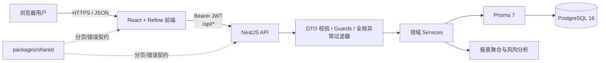
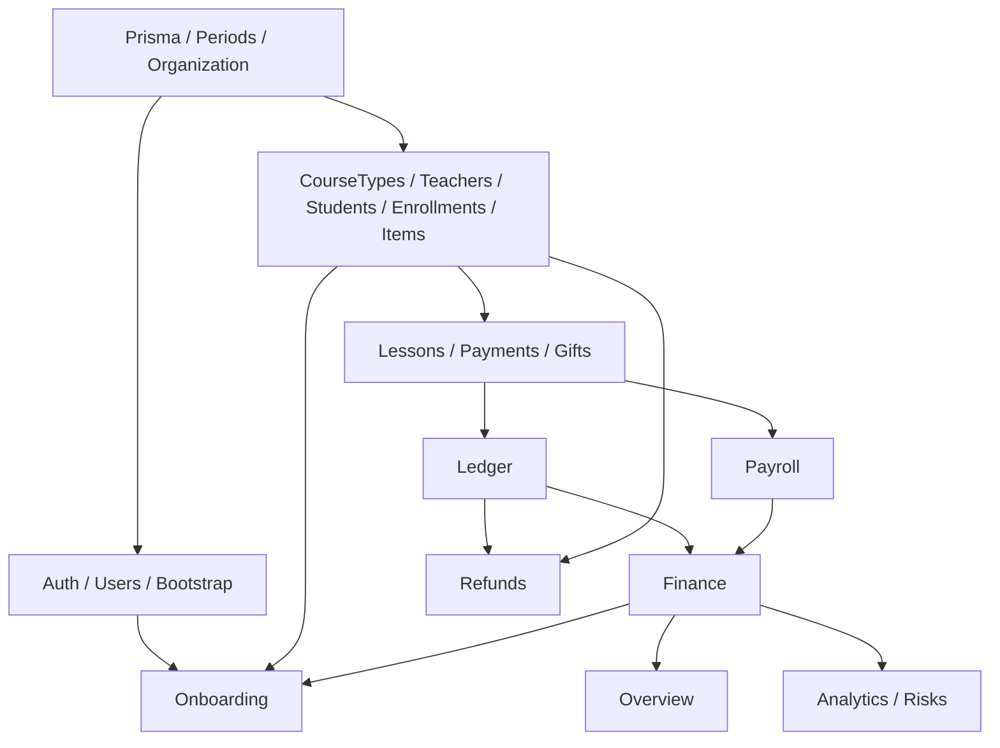
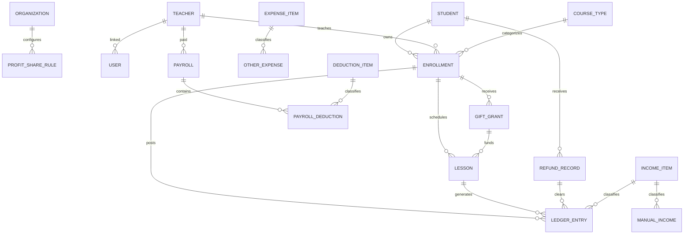
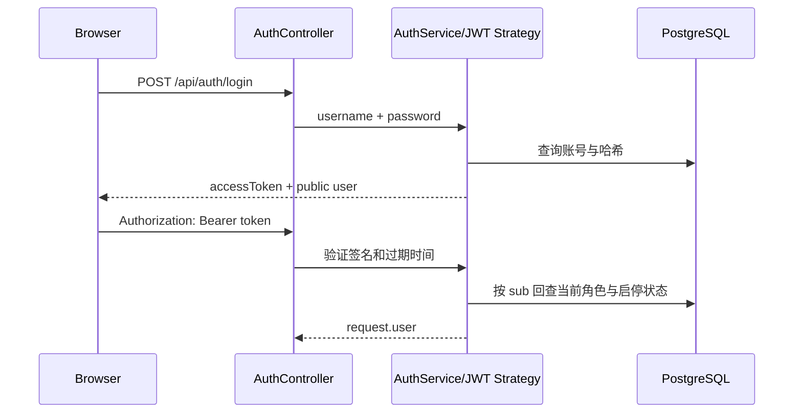

# 琴行管理系统技术设计

> 整理日期：2026-10-14  
> 代码基线：`2e1a948`  
> 文档范围：当前仓库的已实现架构、关键设计决策、接口、数据模型和已知技术边界。

## 1. 系统概览

系统采用前后端分离、同仓管理的 Web 架构：



系统以 PostgreSQL 为业务事实源。前端不执行金额计算，后端 service 负责全部业务规则和聚合；
Prisma schema 是实体、枚举和约束的唯一数据模型来源。

## 2. 技术栈与版本

| 层 | 技术 |
|---|---|
| Monorepo | npm workspaces |
| 后端 | Node.js 20+、TypeScript 6、NestJS 12、ESM |
| ORM | Prisma 7.10.0、`@prisma/adapter-pg` |
| 数据库 | PostgreSQL 16 |
| 鉴权 | Passport JWT、bcrypt |
| 校验 | class-validator、class-transformer |
| 前端 | React 19、Refine 5、Ant Design 5、React Router 7、Vite 5 |
| 测试 | Vitest 4、Supertest |
| 质量 | TypeScript typecheck、oxlint、Prettier |
| 本地编排 | Docker Compose（PostgreSQL） |

依赖版本已锁定。Prisma CLI 与客户端必须保持同版；ESM import 使用带 `.js` 后缀的相对路径。

## 3. 仓库结构

```text
pianomanager/
├── apps/
│   ├── api/
│   │   ├── prisma/
│   │   │   ├── schema.prisma          # 数据模型唯一来源
│   │   │   └── migrations/            # 数据库迁移
│   │   ├── src/
│   │   │   ├── common/                # 金额、月份、装饰器、异常过滤器
│   │   │   ├── config/                # 环境变量校验
│   │   │   ├── modules/               # 领域模块
│   │   │   └── prisma/                # Prisma 唯一接入层
│   │   ├── test/                       # API 端到端测试
│   │   └── scripts/                    # 数据库与业务冒烟
│   └── web/
│       └── src/
│           ├── pages/                  # 业务页面
│           ├── auth-provider.ts        # 登录态适配
│           └── data-provider.ts        # API 唯一调用出口
├── packages/shared/                    # 非实体类共享接口契约
├── docs/                               # 设计与实施文档
├── docker-compose.yml
└── package.json
```

## 4. 后端分层与模块依赖

后端按“基础设施 → 基础资料 → 业务 → 报表 → 编排”组织：



### 4.1 领域模块职责

| 模块 | 主要职责 |
|---|---|
| `bootstrap` | 空库首次创建店主账号。 |
| `auth` / `users` | 登录、身份恢复、账号 CRUD、角色与启停安全规则。 |
| `organization` | 机构单例配置与利润分配规则。 |
| `course-types` / `teachers` / `students` | 基础档案。 |
| `enrollments` | 学生、老师、课程三元组及个性化单价。 |
| `items` | 收入、支出、工资代扣项目及默认模板。 |
| `lessons` | 排课、冲突检查、确认、请假、取消和消费流水。 |
| `payments` | 实收交费流水。 |
| `gifts` | 赠送额度、赠送流水、撤销与活动汇总。 |
| `ledger` | 当前余额、流水、学生和老师维度台账查询。 |
| `refunds` | 流失名单、真退费、保留余额和赠送撤销。 |
| `payroll` | 工资基础项、业绩、课消奖、代扣和我的工资。 |
| `finance` | 收入表、支出表、现金结余、盈利及手工收支。 |
| `periods` | 月份锁定与反关账。 |
| `overview` / `analytics` / `risks` | 总览、排行趋势、欠费与沉睡提醒。 |
| `onboarding` | 八步初始化状态与跨模块编排。 |

### 4.2 依赖约束

- `src/common` 不依赖任何 `src/modules`。
- Prisma 生成物只由 `src/prisma` 封装，禁止直接修改生成目录。
- `lessons` 直接读取赠送数据，不反向依赖 `GiftsService`，避免循环依赖。
- `finance` 可调用工资汇总，`payroll` 不反向依赖 finance。
- controller 只做参数绑定和转发，业务判断必须位于 service。

## 5. 运行时设计

### 5.1 启动流程

1. `main.ts` 先校验环境变量。
2. Nest 创建应用并加载领域模块。
3. Prisma 使用 `PrismaPg` 读取 `DATABASE_URL`。
4. 应用启动阶段执行 `SELECT 1`，真实确认数据库可用。
5. 注册 `/api` 全局前缀、DTO 校验管道、CORS 和全局异常过滤器。
6. 默认监听 `3000` 端口。

### 5.2 环境变量

| 变量 | 要求 |
|---|---|
| `DATABASE_URL` | 必填，PostgreSQL 连接串。 |
| `JWT_SECRET` | 必填，至少 32 字符。 |
| `JWT_EXPIRES_IN` | 默认 `12h`，格式为数字加 `s/m/h/d`。 |
| `PORT` | 默认 `3000`，合法 TCP 端口。 |
| `NODE_ENV` | `development`、`test` 或 `production`。 |
| `CORS_ORIGINS` | 开发默认 `http://localhost:5173`；生产必须显式配置。 |
| `VITE_API_URL` | 前端 API 地址，默认 `http://localhost:3000/api`。 |

配置错误时进程直接退出，不带错误配置继续运行。日志只显示数据库目标的主机、端口和库名，
不得输出完整连接串或密码。

## 6. 数据模型

### 6.1 实体关系概览



### 6.2 数据表分类

| 分类 | 表 |
|---|---|
| 全局设置 | `organizations`、`profit_share_rules` |
| 身份与基础资料 | `users`、`teachers`、`students`、`course_types` |
| 报名与课程 | `enrollments`、`lessons`、`gift_grants` |
| 财务事实 | `ledger_entries`、`refund_records`、`manual_incomes`、`other_expenses` |
| 项目字典 | `income_items`、`expense_items`、`deduction_items` |
| 工资 | `payrolls`、`payroll_deductions` |
| 月结控制 | `closed_periods` |

### 6.3 关键数据库约束

- 机构表通过 `singleton` 唯一约束保证只有一行。
- 用户名、课程类型名和项目名唯一。
- 报名关系 `(studentId, teacherId, courseTypeId)` 唯一。
- 每位老师每月 `(teacherId, period)` 只有一条工资记录。
- 每份工资的同一代扣项只能出现一次。
- `LedgerEntry.reversesEntryId` 唯一，防止同一消费重复回冲。
- 已关账月份 `period` 唯一。
- 老师/学生、流水发生时间、状态等高频条件已建索引。

## 7. 台账与金额设计

### 7.1 双池台账

每条报名关系维护两个逻辑池：实收池和赠送池。数据库只保存起始值与增量：

```text
paidBalance = initialPaidBalance + SUM(ledger.paidDelta)
giftBalance = initialGiftBalance + SUM(ledger.giftDelta)
totalBalance = paidBalance + giftBalance
```

余额计算的唯一权威实现为 `modules/ledger/balance.ts`。任何模块都不能再维护“当前余额”副本。

### 7.2 流水类型

| 类型 | 作用 |
|---|---|
| `PAYMENT` | 交费进入实收池。 |
| `GIFT` | 赠送额度进入赠送池。 |
| `GIFT_REVOKE` | 撤销赠送额度。 |
| `CONSUMPTION` | 确认上课后扣减余额。 |
| `CONSUMPTION_REVERSAL` | 取消/请假时冲回原消费。 |
| `REFUND` | 真退费时清空报名关系余额。 |

### 7.3 精度与序列化

- 金额字段使用 `Decimal(14,2)`，比例使用 `Decimal(6,4)`。
- 业务计算使用 Prisma Decimal，不使用 JavaScript `number` 做金额加减。
- API 金额统一序列化为两位小数字符串。
- 前端直接展示后端金额字符串，不重新计算业务金额。

### 7.4 消费算法

普通课按机构配置的扣减顺序调用 `splitConsumption`：

1. 先从优先池扣到零。
2. 剩余金额从另一池扣除。
3. 两池都不足时允许最后一个池出现负值。
4. 已经为负的余额不视为可用额度。

赠送课按 `GiftGrant.unitPrice` 快照扣赠送池，不使用报名关系的最新单价。

## 8. 事务、一致性与并发

### 8.1 必须原子的流程

| 流程 | 同一事务内的写入 |
|---|---|
| 课程确认 | 状态抢占、单价快照、确认信息、消费流水。 |
| 课程请假/取消 | 状态迁移、反向流水。 |
| 创建赠送 | 赠送记录、赠送流水。 |
| 撤销赠送 | 条件更新撤销标记、反向赠送流水。 |
| 真退费 | 退费记录、各报名清零流水、学生状态、未用赠送撤销。 |
| 工资更新 | 工资 upsert、代扣项整体替换。 |

### 8.2 幂等与并发保护

- 课程确认通过条件更新抢占 `SCHEDULED` 状态，失败返回 409。
- 赠送撤销通过 `revokedAt = null` 条件更新，避免重复撤销。
- 流水回冲依赖唯一 `reversesEntryId` 兜底。
- 业务唯一性由数据库唯一约束兜底，并把 Prisma 冲突转换为可读的 HTTP 409。

### 8.3 当前边界

- 老师同一小时排课冲突检查仍是查询后写入，缺少数据库排他约束。
- 赠送剩余课次检查仍可能在并发确认时超卖。
- 初始化向导中机构接续值和报名接续值不是一个跨服务事务。

建议后续使用事务内行锁、可串行化事务或可由数据库表达的约束补强。

## 9. 鉴权与安全

### 9.1 身份流程



令牌只包含用户 ID，不缓存角色；每个鉴权请求回库读取当前身份，因此停用和角色变更立即生效。

### 9.2 授权模型

- 路由同时挂载 `JwtAuthGuard` 和 `RolesGuard`。
- `@Roles` 控制模块或方法级角色。
- “老师只能访问自己的课程/工资”由 service 进行行级授权。
- 所有返回用户信息的查询使用公开字段白名单，不返回密码哈希。

### 9.3 输入、输出与错误安全

- 全局 ValidationPipe 启用 `whitelist`、`forbidNonWhitelisted` 和 `transform`。
- 未声明字段直接返回 400，避免质量差的客户端数据静默进入系统。
- 500 错误对外统一为“服务器内部错误”，详细栈只写服务端日志。
- 数据库错误、连接串和凭据在日志中脱敏。
- 登录失败文案统一，防止枚举有效用户名。

当前缺少 refresh token、密码修改、登录失败限流、CSRF 专项防护和更细的审计日志。

## 10. API 设计

所有接口前缀为 `/api`，请求和响应使用 JSON；除公开引导、登录和健康检查外均需 Bearer JWT。

### 10.1 公共与账号

| 方法与路径 | 权限 | 用途 |
|---|---|---|
| `GET /health` | 公开 | 数据库健康检查。 |
| `GET /bootstrap/status` | 公开 | 是否需要首次建号。 |
| `POST /bootstrap/owner` | 仅空库 | 创建首位店主。 |
| `POST /auth/login` | 公开 | 登录。 |
| `GET /auth/me` | 登录 | 当前身份。 |
| `GET/POST/PATCH/DELETE /users` | 店主 | 账号管理。 |

### 10.2 基础资料与初始化

| 路径 | 权限 | 用途 |
|---|---|---|
| `/organization` | 登录读、店主写 | 机构设置。 |
| `/organization/profit-shares` | 店主 | 利润分配规则。 |
| `/course-types` | 店主 | 课程类型 CRUD。 |
| `/teachers` | 店主 | 老师档案查询、新增、编辑。 |
| `/students` | 店主 | 学生档案 CRUD。 |
| `/enrollments` | 店主 | 报名关系 CRUD。 |
| `/items/income` | 店主 | 收入项 CRUD。 |
| `/items/expense` | 店主 | 支出项 CRUD。 |
| `/items/deduction` | 店主 | 代扣项 CRUD。 |
| `POST /items/seed-defaults` | 店主 | 幂等创建默认项目。 |
| `/onboarding/status` | 店主 | 初始化进度。 |
| `PUT /onboarding/carry-over` | 店主 | 接续数据。 |
| `POST /onboarding/complete` | 店主 | 完成初始化。 |

### 10.3 核心业务

| 方法与路径 | 权限 | 用途 |
|---|---|---|
| `GET/POST/PATCH/DELETE /lessons` | 店主 | 排课管理。 |
| `GET /lessons/pending` | 店主/老师 | 待确认课程，老师限本人。 |
| `POST /lessons/:id/confirm` | 店主/老师 | 确认课程。 |
| `POST /lessons/:id/leave` | 店主/老师 | 请假并按需回冲。 |
| `POST /lessons/:id/cancel` | 店主/老师 | 取消并按需回冲。 |
| `GET/POST /payments` | 店主 | 交费查询与记账。 |
| `GET/POST /gifts` | 店主 | 赠送查询与创建。 |
| `POST /gifts/:id/revoke` | 店主 | 撤销赠送。 |
| `GET /gifts/summary/by-activity` | 店主 | 活动赠送成本汇总。 |
| `GET /ledger/students/:studentId` | 店主 | 学生余额。 |
| `GET /ledger/entries` | 店主 | 流水分页。 |
| `GET /ledger/by-teacher` | 店主 | 老师维度台账。 |
| `GET/POST /refunds` | 店主 | 退费记录与处理。 |
| `GET /refunds/pending-losses` | 店主 | 待处理流失学生。 |

### 10.4 工资、报表与关账

| 方法与路径 | 权限 | 用途 |
|---|---|---|
| `GET /payroll?period=` | 店主 | 月度工资表。 |
| `PUT /payroll/:teacherId` | 店主 | 更新工资基础项。 |
| `POST /payroll/recompute?period=` | 店主 | 幂等重算。 |
| `GET /payroll/totals?period=` | 店主 | 应发/现金口径。 |
| `GET /payroll/me?period=` | 店主/老师 | 自己的工资。 |
| `/finance/income-statement` | 店主 | 收入表。 |
| `/finance/expense-statement` | 店主 | 支出表。 |
| `/finance/summary` | 店主 | 月度小计、现金结余与盈利。 |
| `/finance/manual-incomes` | 店主 | 手工收入 CRUD。 |
| `/finance/other-expenses` | 店主 | 其它支出 CRUD。 |
| `GET /overview` | 店主 | 经营总览。 |
| `/analytics/*` | 店主 | 老师/学生排行和趋势。 |
| `GET /risks/unpaid` | 店主 | 欠费名单。 |
| `GET /risks/sleeping` | 店主/老师 | 沉睡学生。 |
| `GET /periods/closed` | 店主 | 已关账月份。 |
| `POST /periods/:period/close` | 店主 | 关账。 |
| `POST /periods/:period/reopen` | 店主 | 反关账。 |

### 10.5 通用契约

分页列表：

```ts
type Paginated<T> = {
  items: T[];
  total: number;
  page: number;
  pageSize: number;
};
```

错误响应：

```ts
type ApiErrorBody = {
  statusCode: number;
  message: string;
  code?: string;
  details?: Array<{ field: string; message: string }>;
};
```

前端逻辑分支应使用稳定的 `code`，不得解析给人看的 `message`。

## 11. 前端设计

### 11.1 应用框架

- Refine 负责资源、列表、数据操作、通知和认证集成。
- Ant Design 提供表格、表单、弹窗、日期和金额展示组件。
- React Router 管理登录页、首次建号页和业务页面。
- `data-provider.ts` 是业务页面访问 API 的唯一出口。
- `auth-provider.ts` 管理 JWT 和当前用户缓存；401 自动清除登录态。
- 页面不做余额、工资、盈利等业务计算。

### 11.2 已配置页面

当前菜单包括经营总览、排课与上课、学生台账、学生档案、报名与单价、课程类型、老师档案、
收支管理、工资表、收支项目、经营分析、风险提醒、账号管理和初始化向导。

### 11.3 前端缺口

现有路由尚未覆盖交费、赠送、退费、关账和独立机构设置；账号页也未完整提供新增、改密和老师关联。
这意味着后端能力已存在，但业务人员仍需新增 UI 才能从浏览器完成全流程。

此外，菜单目前未按角色动态裁剪。后端授权仍能保证安全，但老师体验会出现可见菜单点击后返回 403。

## 12. 报表设计

### 12.1 收入表

- 人工收入项：当月交费流水 + 手工收入。
- 课时消费：当月已确认且非赠送课程的单价快照。
- 退费手续费：当月退费记录的手续费。
- 同时返回当月、上月止本年累计和本月止本年累计。

### 12.2 支出表

- 工资、赠课成本、利润分配和退费由自动来源计算。
- 普通支出来自 `OtherExpense`。
- 每行同时返回现金口径和经营口径，防止用单一金额解释两套经营视角。

### 12.3 工资与总览

- 工资人工项落库，业绩和课消奖实时汇总。
- 总览通过 FinanceService 的统一口径生成指标、构成、趋势和利润分配。
- Analytics 与 Risks 读取相同业务事实，不维护第二套统计值。

## 13. 测试与质量门禁

### 13.1 当前测试结构

- 各 service 使用 Vitest 单元测试验证规则、权限、金额和异常分支。
- `app.module.spec.ts` 验证健康检查、鉴权、错误信封和全局 DTO 管道。
- `test/app.e2e-spec.ts` 提供真实 API 端到端测试入口。
- `scripts/smoke-business.py` 覆盖建号、登录、报名、交费、排课、确认、台账、收支和排行主链路。
- 当前代码中的 253 个单元/集成测试均已通过（本次基线校验结果）。

### 13.2 必过门禁

后端普通改动：

```bash
npm run typecheck -w @piano/api
npm run lint -w @piano/api
npm test -w @piano/api
```

前端改动：

```bash
npm run typecheck -w @piano/web
npm run build -w @piano/web
```

数据库或接口改动还需执行迁移、端到端和业务冒烟。

## 14. 部署与运维

### 14.1 本地开发

```bash
npm install
cp apps/api/.env.example apps/api/.env
npm run db:up
npm run db:migrate -w @piano/api
npm run start:dev -w @piano/api
npm run dev -w @piano/web
```

默认地址：

- 前端：`http://localhost:5173`
- API：`http://localhost:3000/api`
- PostgreSQL：`localhost:5433/piano`

### 14.2 数据库迁移

- 开发环境使用 `prisma migrate dev`。
- 部署环境使用 `prisma migrate deploy`。
- 已应用迁移不可修改，所有结构调整新增迁移。
- 数据库卷需纳入备份、恢复演练和留存策略。

### 14.3 健康与日志

- `GET /api/health` 通过真实 `SELECT 1` 检查数据库。
- 500 级错误记录服务端堆栈，对外返回通用错误。
- 当前没有结构化日志、请求关联 ID、指标和链路追踪，生产部署前应补齐。

## 15. 技术债与演进建议

按优先级建议如下：

1. **补齐业务 UI 闭环**：交费、赠送、退费、关账、机构设置、完整账号管理。
2. **补强并发一致性**：排课冲突和赠送额度使用数据库级互斥或串行化事务。
3. **修复初始化原子性**：允许 OrganizationService 使用事务客户端，将接续数据整体提交。
4. **补齐账号安全**：refresh token、改密、密码重置、登录限流和安全审计。
5. **增加生产可观测性**：结构化日志、request ID、错误聚合、指标和告警。
6. **梳理删除策略**：对需要长期追溯的学生、账号和基础资料采用软删除或归档。
7. **校正环境脚本**：`local-db-and-smoke.sh` 包含 Windows 盘符硬编码，在当前 macOS 路径下不可直接运行。
8. **刷新仓库说明**：根 README 与 `apps/web/README.md` 仍写“前端尚未开始”，应与实际状态同步。
9. **完善 API 文档**：可引入 OpenAPI/Swagger 生成机器可读契约，减少前后端手工对齐成本。

## 16. 关键代码索引

| 主题 | 路径 |
|---|---|
| 数据模型 | `apps/api/prisma/schema.prisma` |
| 应用模块图 | `apps/api/src/app.module.ts` |
| 启动与全局管道 | `apps/api/src/main.ts` |
| 金额工具 | `apps/api/src/common/money.ts` |
| 月份工具 | `apps/api/src/common/period.ts` |
| 余额算法 | `apps/api/src/modules/ledger/balance.ts` |
| 课程确认/回冲 | `apps/api/src/modules/lessons/lessons.service.ts` |
| 退费事务 | `apps/api/src/modules/refunds/refunds.service.ts` |
| 工资计算 | `apps/api/src/modules/payroll/payroll.service.ts` |
| 收支报表 | `apps/api/src/modules/finance/finance.service.ts` |
| 前端路由 | `apps/web/src/App.tsx` |
| 前端 API 适配 | `apps/web/src/data-provider.ts` |
| 共享契约 | `packages/shared/src/index.ts` |
