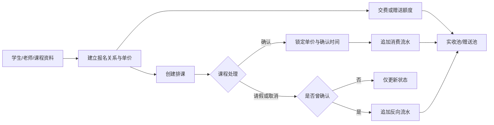
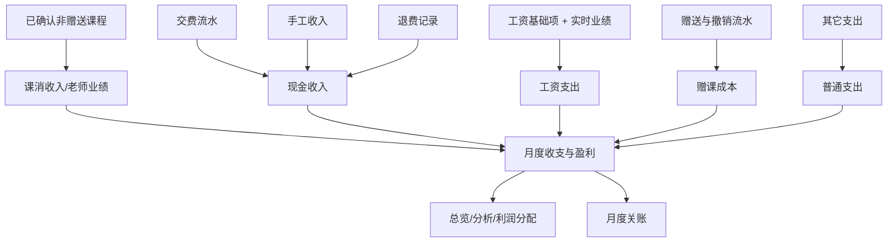

# 琴行管理系统需求设计

> 文档性质：当前实现基线说明，不替代原始业务需求。
>
> 整理日期：2026-10-14  
> 代码基线：`2e1a948`  
> 依据：`prisma/schema.prisma`、各领域 service/controller、前端页面及仓库内实施计划。

## 1. 文档定位

仓库约定指出，原始业务需求的唯一来源位于另一个仓库的
`docs/需求-用户故事.md`，该文件不在当前工作区。本说明因此不复制或替代原始需求，
而是把当前代码实际表达的业务目标、规则、权限、验收口径与交付边界整理成可评审的实施基线。

当本说明与原始业务需求冲突时，应回到原始需求确认，并同步修改代码、测试与本说明。

## 2. 产品目标

系统面向单个琴行，打通以下经营闭环：

1. 建立机构、账号、老师、学生、课程和收支项目等基础资料。
2. 为学生建立“学生 + 老师 + 课程”的报名关系，并维护个性化课程单价。
3. 完成排课、上课确认、课消扣减、赠课、交费、退费及余额追踪。
4. 从业务流水自动生成工资、收支、经营总览、排行和风险提醒。
5. 通过月度关账保护历史数据，保留可追溯的经营凭据。

系统不是通用教务 SaaS。当前范围为单机构、两种账号角色、人民币两位小数金额和按月经营核算。

## 3. 角色与使用边界

### 3.1 角色

| 角色 | 说明 |
|---|---|
| 店主（OWNER） | 系统管理员和经营负责人，可维护基础资料、业务流水、工资、报表与关账。 |
| 授课老师（TEACHER） | 可查看并处理自己的待确认课程，查看自己的工资，以及查看沉睡学生提醒。 |

老师账号可关联一份老师档案；没有关联老师档案的老师账号不能访问“自己的课程/工资”数据。

### 3.2 权限矩阵

| 能力 | 店主 | 授课老师 |
|---|---:|---:|
| 首次创建店主账号 | 空库时可操作 | 不适用 |
| 机构设置、利润分配、账号管理 | 读写 | 仅可读取机构基本信息 |
| 课程、老师、学生、报名、收支项目 | 读写 | 无权 |
| 排课增删改查 | 读写 | 无权 |
| 待确认课程、确认、请假、取消 | 全部课程 | 仅自己的课程 |
| 交费、赠送、退费、学生台账 | 读写 | 无权 |
| 工资表 | 全部老师 | 仅自己的工资 |
| 收支、总览、排行、欠费 | 可见 | 无权 |
| 沉睡学生 | 可见 | 可见 |
| 关账与反关账 | 可操作 | 无权 |

权限必须由服务端强制执行，前端隐藏菜单不能代替鉴权。

## 4. 核心业务对象

| 对象 | 业务含义 |
|---|---|
| 机构 | 单例全局设置，包括默认提成、退费手续费、扣费顺序和首月接续数据。 |
| 用户 | 登录账号，角色为店主或授课老师，可关联老师档案。 |
| 老师 | 授课人员档案，包含状态、默认工资和个人提成覆盖值。 |
| 学生 | 学员档案，包含学习级别、在读/停课/退学状态和退费意向。 |
| 课程类型 | 琴行提供的课程类别，可排序、停用。 |
| 报名关系 | 学生、老师、课程三元组，保存该组合的单价、生效区间和接续余额。 |
| 排课 | 一次计划课程，可确认、请假或取消，也可标记为赠送课。 |
| 台账流水 | 实收池、赠送池的不可变金额变动记录。 |
| 赠送额度 | 某报名关系获赠的课次和金额快照，可被赠送课占用或撤销。 |
| 退费记录 | 学生退费或保留余额的处理凭据。 |
| 工资记录 | 老师某月人工录入的工资基础项和代扣项。 |
| 收支记录 | 自动汇总项、手工收入和其它支出。 |
| 关账月份 | 已锁定、禁止继续写入业务数据的月份。 |

## 5. 功能需求

### 5.1 首次初始化与登录

1. 空库状态下允许创建第一个店主账号；已有任意账号后必须拒绝再次调用首次创建接口。
2. 初始化向导包含机构资料、老师、课程、学生、报名、收支模板、接续数据和完成确认八类检查。
3. 首月接续数据包括期初现金、上月盈利、上月应发工资，以及各报名关系的起始实收余额、赠送余额和单价。
4. 初始化完成前必须校验影响首月报表的必要数据，不能用默认零值掩盖“尚未录入”。
5. 用户以用户名和密码登录。用户不存在、密码错误、账号停用三类失败统一提示“用户名或密码不正确”。
6. 登录成功后签发访问令牌；停用账号和角色变更应在下一次请求立即生效。

### 5.2 机构、账号与基础资料

1. 机构资料包含名称、城市、填报人、默认课消奖比例、退费手续费率、赠送余额开关和扣费顺序。
2. 利润分配规则由一个或多个分配人及比例构成，启用规则比例总和必须等于 100%。
3. 店主可新增、编辑、停用账号，并关联老师档案；不得停用或删除当前登录账号。
4. 系统必须始终保留至少一个启用的店主账号。
5. 课程类型、收入项、支出项和工资代扣项支持排序、停用和安全删除；已被历史业务引用的项目不得硬删。
6. 老师档案支持状态、岗位、入职时间、个人课消奖比例和默认基本工资。
7. 学生档案支持 1～10 级教学分级、状态、退费意向和备注；教学级别不参与价格计算。

### 5.3 报名与个性化单价

1. 报名关系由学生、老师和课程唯一确定，同一三元组不得重复。
2. 每条报名关系维护独立单价和生效区间，不使用全局课程价目表。
3. 单价必须大于零；退学学生、停用老师或停用课程不得新增报名关系。
4. 报名建立后只允许修改单价和生效区间；身份三元组和起始余额不可修改。
5. 已有课程或台账流水的报名关系不得删除。
6. 修改单价不得追溯影响历史课消；历史课程按确认时锁定的单价快照核算。

### 5.4 排课与上课确认

1. 店主按学生、老师、课程和时间创建排课；系统必须先找到对应报名关系。
2. 同一老师同一小时内不得存在另一节有效排课。
3. 排课可修改时间、课程、赠送属性和备注；已确认课程不得修改影响账务的字段。
4. 待确认列表支持店主查看全部或指定老师，老师只能查看自己的课程。
5. 确认课程时锁定单价、确认时间和确认人，并在同一事务中追加课消流水。
6. 只有店主可以补录确认时间；老师确认课程时由服务器记录当前时间。
7. 已确认课程请假或取消时必须追加反向流水，不得删除或修改原消费流水。
8. 同一课程不得重复确认，同一消费流水不得重复回冲。

### 5.5 交费、余额与赠送

1. 每条报名关系有实收池和赠送池：

   ```text
   实收余额 = 起始实收余额 + Σ 实收池变动
   赠送余额 = 起始赠送余额 + Σ 赠送池变动
   总余额   = 实收余额 + 赠送余额
   ```

2. 当前余额不得存成独立字段，必须由起始值和全部台账流水实时计算。
3. 交费金额必须大于零，进入实收池，并关联一个启用的手工收入项。
4. 普通课确认时按机构设置的 `赠送优先` 或 `实收优先` 扣减；余额不足时允许扣成负数以形成欠费。
5. 预计剩余课时按“总余额 ÷ 当前单价”计算并保留一位小数。
6. 赠送记录包含活动、课次、折算单价和金额；创建时向赠送池追加额度。
7. 赠送课必须绑定有效且尚有剩余课次的赠送记录，确认时只扣赠送池。
8. 赠送课不计入老师业绩，也不计入课时消费收入。
9. 尚未被已确认赠送课使用的赠送记录可撤销；撤销以反向流水冲回。

### 5.6 退费与流失处理

1. 待处理流失名单包括已退学学生和标记退费意向的学生，并显示其实收、赠送余额。
2. 真退费时：

   - 按学生所有报名关系汇总当前余额；
   - 手续费 = 实收余额 × 手续费率；
   - 实退金额 = 实收余额 − 手续费；
   - 为每条报名关系追加清零流水；
   - 撤销未用完的赠送额度；
   - 学生状态改为退学并清除退费意向。

3. 保留余额时不写台账流水，实收池和赠送池保持不变，学生状态改为停课。
4. 两种处理都必须保存退费记录；已退学学生不得重复退费。

### 5.7 工资

1. 工资按老师、月份展示，每位老师每月最多一条人工基础记录。
2. 老师业绩 = 当月已确认且非赠送课程的单价快照之和。
3. 课消奖 = 老师业绩 × 有效提成比例；比例优先级为“当月工资覆盖 > 老师档案 > 机构默认”。
4. 应发工资 = 基本工资 + 钢琴奖 + 招生奖 + 课消奖。
5. 实发工资 = 应发工资 − 代扣合计。
6. 业绩和课消奖实时计算，不单独落库；“重新汇总”操作必须幂等且不改写工资记录。
7. 店主可维护出勤、基本工资、奖励、提成覆盖、备注和动态代扣项。
8. 老师只能查看与其账号关联的自己的工资和课时。

### 5.8 收入、支出与月度核算

1. 收入表按月份和收入项展示现金口径、课消口径、上月累计和本年累计。
2. 手工收入项的现金额来自交费流水与手工补录；课时消费和退费手续费由系统自动取数。
3. 支出表按月份展示现金口径和经营口径：

   - 工资：经营口径取本月应发，现金口径取实际工资现金口径；
   - 赠课成本：计经营支出，不计现金支出；
   - 利润分配：计现金支出，不计经营支出；
   - 退费：计现金支出，不计经营支出；
   - 普通支出：现金与经营口径相同。

4. 现金结余 = 期初现金 + 截至当月累计现金收入 − 累计现金支出。
5. 盈利 = 当月课消收入 − 当月经营支出。
6. 首月没有历史月份时，工资与利润分配计算使用初始化录入的上月数据。
7. 手工收入和其它支出必须关联人工项目，自动取数项目不得手工记账。

### 5.9 关账

1. 店主可以锁定或重新打开一个 `YYYY-MM` 月份。
2. 已关账月份禁止新增、修改或删除会影响台账、收支或工资的数据。
3. 数据归属月份由业务发生时间决定；课程消费按确认时间归属。
4. 关账只锁写入，不生成金额、不复制快照。

### 5.10 总览、分析与风险提醒

1. 经营总览按月展示收入、支出、现金结余、盈利等指标卡和本年累计。
2. 总览展示收入构成、支出构成、利润趋势和上月利润分配。
3. 分析展示老师业绩排行、老师近 1～12 个月趋势和学生消费排行；排名由服务端生成。
4. 欠费名单列出总余额为负且未退学的学生/报名关系。
5. 沉睡学生定义为超过 40 天没有已确认课程的未退学学生；从未确认过课程的学生单列。

## 6. 关键业务流程

### 6.1 从报名到课消



### 6.2 月度经营核算



## 7. 全局业务不变量

1. 金额以十进制定点数计算，精度统一为两位小数；比例最多四位小数。
2. 时间以 UTC 存储，月份边界按系统约定的 UTC+8 业务时区计算。
3. 台账只追加，不改不删；历史调整通过反向流水完成。
4. 余额只计算不存储，课消历史使用单价快照。
5. 跨表写入必须在同一数据库事务中完成。
6. 受唯一性保护的业务身份由数据库约束兜底，不能只依赖“先查再写”。
7. 关账月份不可写；所有金额写入口必须经过关账检查。
8. 业务规则只在服务端执行，前端只负责输入、展示和交互确认。

## 8. 非功能需求

| 类别 | 要求 |
|---|---|
| 安全 | 密码使用 bcrypt 哈希；JWT Bearer 鉴权；角色与行级权限服务端校验；错误不泄露 SQL、栈或连接串。 |
| 数据一致性 | 金额使用 Decimal；关键流程使用事务；台账追加式记账；数据库唯一约束防重复。 |
| 可追溯性 | 流水记录发生时间、类型、关联业务和制单人；取消与请假保留原始消费。 |
| 可用性 | 启动时校验环境变量并真实探测数据库；提供健康检查接口。 |
| 性能 | 列表分页；常用时间、状态和外键字段建立索引；报表聚合在服务端完成。 |
| 可维护性 | 前后端同仓；Prisma schema 为数据模型唯一来源；领域模块分层；统一分页和错误响应。 |
| 兼容性 | Node.js 20+；现代浏览器；前端默认运行于 5173 端口，API 默认运行于 3000 端口。 |
| 测试 | 单元测试覆盖核心规则；数据库/接口改动需通过端到端与业务冒烟。 |

## 9. 端到端验收场景

### 9.1 主业务链路

1. 空库创建首位店主并登录。
2. 完成机构、老师、课程、学生、报名关系和收支模板配置。
3. 录入首月接续数据并完成初始化。
4. 为学生交费并创建赠送额度，台账两池金额正确。
5. 创建普通课和赠送课并确认，余额、老师业绩和课消收入口径正确。
6. 对已确认课程请假，产生一条反向流水，余额恢复且原流水保留。
7. 录入工资基础项、其它支出和手工收入，月度收支与总览正确。
8. 执行退费，余额清零、状态变更、手续费和实退额进入正确报表口径。
9. 关账后尝试修改该月金额数据，系统返回冲突；反关账后允许继续处理。

### 9.2 权限链路

1. 授课老师不能访问基础资料、台账、收支或他人工资。
2. 授课老师只能确认、请假、取消自己的课程。
3. 授课老师只能读取自己的工资，但可读取沉睡学生名单。
4. 停用账号持有的旧令牌不能继续访问系统。

### 9.3 边界链路

1. 重复报名、重复确认、重复回冲、重复退费均被拒绝。
2. 余额不足时允许形成欠费，不截断为零。
3. 已使用赠送额度不能撤销。
4. 历史业务已引用的基础资料不能硬删。
5. 零单价、非正交费、非法月份、越界比例和未知字段均被拒绝。

## 10. 当前实现状态与交付缺口

### 10.1 已有实现

- 后端已覆盖初始化、鉴权、基础资料、报名、排课、交费、赠送、台账、退费、工资、收支、关账、总览、分析和风险提醒。
- 前端已有登录、首次建号、初始化、总览、课程、老师、学生、报名、排课、台账、收支、工资、项目、分析、风险和账号页面。
- 当前仓库包含 253 个已通过的单元/集成测试，以及一个数据库端到端测试入口和业务冒烟脚本。

### 10.2 尚未形成完整前端闭环

| 缺口 | 影响 |
|---|---|
| 无独立交费页面/动作入口 | 后端可记交费，但日常操作无法仅靠当前 UI 完成。 |
| 无赠送额度与撤销页面 | 赠课业务后端完整，前端不可管理。 |
| 无退费/保留余额页面 | 流失处理不能从当前 UI 完成。 |
| 无关账/反关账页面 | 历史月份保护需要直接调用 API。 |
| 无初始化完成后的机构设置页 | 机构参数和利润分配只能借助初始化页修改。 |
| 账号页仅列表与停用/角色调整 | 新增账号、密码维护和老师关联能力未完整暴露。 |
| 老师视角导航未按权限裁剪 | 后端会拒绝越权，但老师仍可能看到无权菜单并收到 403。 |
| 缺 refresh token、改密、登录限流 | 长期会话与账号安全流程仍需补齐。 |

### 10.3 已知一致性与并发边界

- 初始化接续数据中的机构更新与报名更新并非严格处于同一事务。
- 排课时间冲突和赠送额度可用性主要采用“先查后写”，高并发下仍需数据库级约束或锁机制。
- 学生和用户仍采用受保护的硬删除策略；后续审计要求提高时应评估软删除。

## 11. 需求追踪说明

代码注释中保留的故事编号包括：

- `US-AC`：账号与权限
- `US-BD`：基础资料
- `US-SC`：排课
- `US-CC`：上课确认
- `US-ML`：学生台账与交费
- `US-GL`：赠送
- `US-RF`：退费
- `US-PR`：工资
- `US-IE`：收支
- `US-PC`：关账
- `US-OV`：经营总览
- `US-AN`：经营分析
- `US-RA`：风险提醒
- `US-IW`：初始化向导

详细的故事原文和最终验收优先级仍应从原始需求仓库取得后补充评审。
